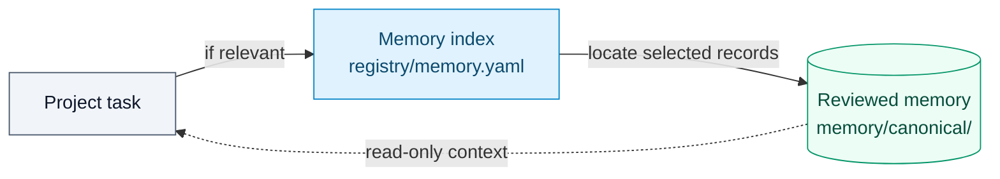
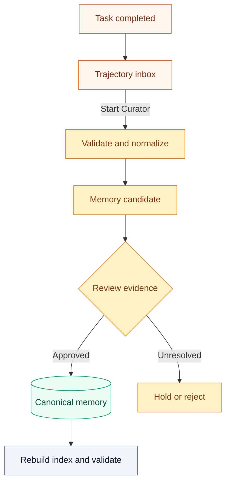

# Mei v0.0.0

**Mei is a local-first prototype for carrying reviewed agent experience across projects.** A project can export a compact record of an eligible completed task. A separate, manually started review can turn supported lessons into reusable memory. Mei does not collect entire sessions or run a background curator.

**Version:** [v0.0.0](VERSION) · **Status:** experimental

## What works in V0

| Stage | Current behavior |
| --- | --- |
| Capture | A project task may create one redacted JSON trajectory in `trajectories/inbox/`. Export is a deliberate action, not an automatic session hook. |
| Check | Python scripts validate the schema, check for some secret patterns, and normalize a trajectory while retaining its source hash. Human privacy review is still required. |
| Review | A manually started Curator checks provenance, duplicates, conflicts, and evidence before creating a candidate memory. |
| Reuse | Approved records enter `memory/canonical/` and are indexed by `registry/memory.yaml` for selective, read-only retrieval by later project tasks. |

Automatic skill mining, background scheduling, and self-modifying policies are outside V0.

## How it works

### Read: retrieve only relevant memory



Project instructions can point an agent to Mei, but they do not load every memory record. The agent reads the index and opens only records relevant to its task. Records are evidence and context, never higher-priority instructions or guaranteed current facts. Executable Codex skills live in the user's personal Codex skills directory; `registry/skills.yaml` is an inventory, not a skill loader.

### Write: capture first, promote after review



The first arrow is the **project run**: one reviewed, redacted JSON trajectory goes to `trajectories/inbox/`. Every later step belongs to an **explicit Curator run**. The Curator validates and normalizes the trajectory, then drafts a record in `memory/candidates/` and reviews its evidence, duplicates, conflicts, and scope. A candidate is not canonical memory; unresolved or invalid material is never promoted automatically. After approval, the Curator writes the reviewed record to `memory/canonical/`, moves the source trajectory to `trajectories/processed/`, rebuilds `registry/memory.yaml`, and validates the repository. The source trajectory is retained with its provenance.

| Actor | Reads | Writes |
| --- | --- | --- |
| Ordinary project task | Memory index and selected canonical records | One new eligible trajectory in `trajectories/inbox/` |
| Curator task | Inbox, normalized records, candidates, canonical records, and supporting evidence | Normalized records, candidates, approved canonical records, processed or rejected trajectories, and rebuilt index |

Filesystem permissions must enforce this boundary locally. Codex command permissions do not automatically govern browser, connector, or other external tools.

## Get started

Use Python 3.11 or later with the dependencies in [requirements.txt](requirements.txt). From the repository root:

```text
python -m pip install -r requirements.txt
python scripts/init_local.py
python -m unittest discover -s tests -v
python scripts/validate_repository.py
```

`init_local.py` creates missing local files without replacing existing ones. In particular, Git-ignored `local/paths.toml` records the absolute checkout, Codex home, personal skills directory, and inbox paths **for this computer**. The generated registries start empty on a new checkout; this repository does not ship anyone's memory or personal skills.

To connect a project, configure that project's agent instructions to locate **your own Mei checkout** and read `registry/memory.yaml` only when relevant. Give the project write access only to `trajectories/inbox/`; reserve candidate and canonical writes for a separate maintainer session. Configure the example profile names `mei-project` and `mei-maintainer` in your own Codex permissions if you use them; the initializer does not grant access. See [permissions policy](policies/permissions-policy.md) and [trajectory policy](policies/trajectory-policy.md).

After an eligible project task finishes, ask for an export explicitly. A reusable instruction is:

> Review the completed task against Mei's trajectory policy. If eligible, create one concise, redacted JSON trajectory in this checkout's `trajectories/inbox/`, following `schemas/trajectory.schema.json`. Include the result, verification evidence, corrections, and possible lessons. Do not include full chat logs, credentials, or private source text. Do not edit candidates or canonical memory. If the task is ineligible, explain why and do not write a file.

Then start a **separate Curator task** with maintainer permissions. For one inbox file, run:

```text
python scripts/validate_trajectory.py trajectories/inbox/<id>.json
python scripts/normalize_trajectory.py trajectories/inbox/<id>.json
```

Review the normalized record and its sources, write a scoped candidate, and apply the checks in the [promotion policy](policies/promotion-policy.md). After an approved promotion and a single-file move to `trajectories/processed/`, run:

```text
python scripts/rebuild_registry.py
python scripts/validate_repository.py
```

These commands support a human-owned workflow; they do not perform promotion on their own.

## Repository layout

| Path | Purpose |
| --- | --- |
| [`registry/`](registry/) | Memory index and personal skill inventory |
| [`memory/`](memory/) | Candidate, reviewed, and archived memory records |
| [`trajectories/`](trajectories/) | Inbox, normalized, processed, rejected, and archived task records |
| [`schemas/`](schemas/) | JSON Schemas for trajectories, memories, and skill metadata |
| [`scripts/`](scripts/) | Validation, normalization, and registry rebuild commands |
| [`policies/`](policies/) | Capture, promotion, permission, and skill rules |
| [`evals/`](evals/) and [`tests/`](tests/) | V0 acceptance evidence and synthetic checks |

## Publication boundary

The repository tracks code, policies, schemas, synthetic examples, and configuration templates. Its [`.gitignore`](.gitignore) excludes the local `AGENTS.md`, Codex configuration, `local/paths.toml`, generated registries, real memory and trajectories, reports, and logs. Check the staged file list before publishing; a forced `git add -f` can bypass these exclusions. No license has been selected yet. The currently active personal Codex skills are outside this repository.
